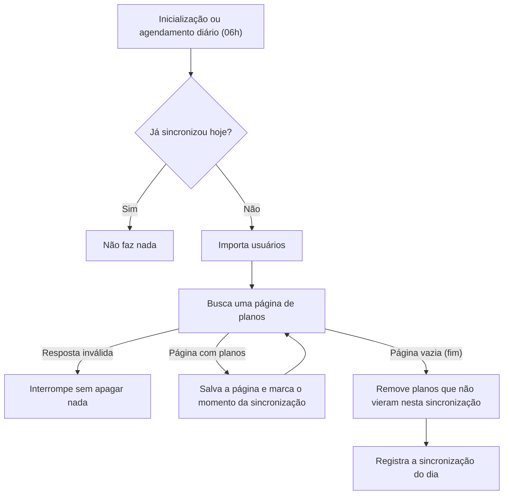

# 📊 Sistema de Monitoramento do PGD na ANTT

<p align="center">
  
  
  
  
  
</p>

Sistema web que apoia o monitoramento dos Planos de Trabalho do **PGD (Programa de Gestão e Desempenho)** na ANTT. Ele sincroniza automaticamente os dados do sistema de PGD da agência, aplica as regras de negócio de pendência e entrega consultas, um painel de acompanhamento e exportação em CSV.

> Projeto desenvolvido e mantido para uso interno da Coordenação de Frequência e PGD (CFPGD), com o objetivo de automatizar um acompanhamento que antes era feito manualmente.

---

## 📋 Sobre o projeto

No PGD, cada servidor tem planos de trabalho mensais com uma meta de horas. Durante o mês, o servidor registra o que entregou e a chefia avalia o plano. O sistema de PGD usado pela ANTT não oferece uma forma prática de extrair relatórios nem de enxergar esses dados de forma consolidada, e era justamente essa a lacuna que eu queria resolver.

Este projeto busca os dados na **API do sistema de PGD da ANTT**, guarda tudo em um banco próprio e, a partir daí, responde às perguntas do dia a dia da coordenação:

- Quais planos ainda dependem de ação do **servidor**?
- Quais planos já estão completos e aguardam a **avaliação da chefia**?
- Quais unidades concentram mais pendências?
- Qual é o histórico de planos de um servidor?

Hoje a base tem cerca de **17 mil planos**, sincronizados todos os dias.

---

## ⚙️ Funcionalidades

**🔄 Sincronização automática**
- Importa usuários e planos da API de origem na inicialização e todos os dias às 06h
- Evita repetir a sincronização no mesmo dia
- Remove planos que deixaram de existir na origem, mas só quando a sincronização termina por completo

**🔍 Consultas**
- Histórico completo de planos de um servidor, pela matrícula SIAPE
- Planos por período de vigência
- Pendências do servidor, agrupadas por servidor
- Pendências da chefia, agrupadas por unidade

**📈 Painel de monitoramento**
- Resumo do mês passado, do mês retrasado e do período acumulado
- Adimplência (percentual de planos já avaliados)
- Ranking das 5 unidades com mais pendências

**📤 Exportação e API**
- Exportação em CSV das pendências do servidor e da chefia
- Endpoints REST que devolvem em JSON os mesmos dados das telas

---

## 🔄 Como a sincronização funciona



Alguns cuidados que fazem parte desse fluxo:

- **A API sinaliza o fim só com uma página vazia.** Por isso o deslocamento (offset) avança pelo tamanho real de cada página, e não pela quantidade de planos que passam no filtro. Do contrário, uma página inteira filtrada faria o laço rodar para sempre.
- **Usuários que não aparecem na listagem de usuários** (por exemplo, sem lotação ativa) são criados a partir dos dados que vêm junto com o próprio plano, evitando plano sem dono no banco.
- **A remoção de planos excluídos na origem** usa o momento da sincronização: o que não foi atualizado nesta rodada é removido. Esse passo só roda se a sincronização chegou até o fim.
- **Um intervalo entre páginas** evita sobrecarregar o sistema de origem.

---

## 📏 Regras de negócio

| Situação | Critério | Período considerado |
|---|---|---|
| **Pendência do servidor** | Horas entregues **abaixo** da meta prevista e plano ainda não avaliado | Até o mês atual − 1 |
| **Pendência da chefia** | Meta de horas **cumprida**, mas plano ainda não avaliado | Até o mês atual − 2 (prazo de avaliação) |
| **Adimplência** | Percentual de planos que já foram avaliados, concluindo o fluxo | Conforme o período do painel |

- O acompanhamento começa em **junho de 2024**, quando passou a valer a resolução atual do PGD na ANTT.
- A pendência da chefia só conta a partir do mês atual − 2 porque os dois últimos meses ainda estão dentro do prazo de avaliação.
- Unidades marcadas como inativas são desconsideradas nas consultas de período, de pendência e no painel.

---

## 🏗️ Arquitetura

O projeto é organizado em camadas, cada uma com sua responsabilidade:

```
controllers/
  ├── view/        → Telas (Thymeleaf)
  └── rest/        → Endpoints JSON
services/
  ├── imports/     → Sincronização com a API de origem
  └── responses/   → Regras de negócio, agregações e painel
repositories/      → Consultas com Spring Data JPA (JPQL)
entities/          → Entidades JPA (Usuario, Plano)
dtos/
  ├── imports/     → Leitura do JSON externo, tratando dados inconsistentes
  ├── responses/   → Estruturas agregadas para telas e painel
  └── reports/     → Layout da exportação CSV
mappers/           → Conversão entre entidades e DTOs
enums/             → Status de execução e tipos de perfil
utils/             → Regras de data e prazo centralizadas
```

---

## 🧠 Decisões técnicas

- **Paginação em duas etapas.** Primeiro o banco devolve só os IDs da página, depois um `JOIN FETCH ... WHERE id IN` traz os dados completos. Isso evita paginar em memória e o problema de N+1.
- **Contar no banco ou na memória, conforme o volume.** O total do período, com milhares de planos, é um `COUNT` no banco. Os recortes mensais, bem menores, são separados em memória com `Collectors.partitioningBy`.
- **DTOs de importação tolerantes.** A API de origem tem particularidades, como datas `0000-00-00`, campos vazios e um campo que às vezes vem como `boolean` e às vezes como lista. Os setters customizados tratam isso na entrada, para não espalhar esses cuidados pelo resto do código.
- **`equals`/`hashCode` restritos ao `id`** nas entidades (`@EqualsAndHashCode(onlyExplicitlyIncluded = true)`), evitando os problemas clássicos de identidade mutável em JPA.
- **Consultas com `@Transactional(readOnly = true)`.**
- **Nenhuma URL, chave ou credencial no código.** Tudo que é sensível vem de variáveis de ambiente.
- **Telas com `th:text` por padrão**, o que escapa o conteúdo e previne XSS. O `th:utext` aparece só no fragmento dos cards explicativos, que recebe textos fixos escritos nos próprios templates, nunca dados do banco ou do usuário.

---

## 🧩 Problemas reais que apareceram no caminho

Algumas das coisas que mais me ensinaram durante o desenvolvimento:

- **Uma sincronização apagou todos os planos do banco.** A remoção compara o momento de cada plano com o momento da sincronização. O `LocalDateTime.now()` tem precisão de nanossegundos, mas a coluna guarda só microssegundos. O valor gravado ficava "menor" que o da comparação, e os planos recém-salvos eram removidos na mesma rodada. A correção foi truncar o momento da sincronização em segundos.
- **Uma sincronização com escopo reduzido também removeu planos.** Com um perfil de acesso mais restrito na origem, a API respondeu normalmente, só que com uma fração dos dados, e a remoção tratou o resto como excluído. Os dados foram recuperados com uma nova sincronização completa, e a trava de volume está nos próximos passos.
- **Usuários "sumidos".** Alguns servidores não vinham na listagem de usuários da API e quebravam a relação com os planos. Resolvi criando esses usuários a partir dos dados que já chegam junto com cada plano.

---

## 🧰 Tech Stack

| Categoria | Tecnologia |
|---|---|
| Linguagem | Java 17 |
| Framework | Spring Boot 3.5.14 (Web, Data JPA, Scheduling) |
| Persistência | Spring Data JPA / Hibernate + H2 |
| Integração | `RestTemplate` + Jackson |
| Exportação | OpenCSV 5.12.0 |
| Utilitários | Lombok 1.18.34, Apache Commons Lang3 3.12.0 |
| Interface | Thymeleaf (renderização no servidor), AdminLTE 3 e Chart.js |
| Build | Maven |

---

## 🌐 Endpoints

### Telas

| Rota | Descrição |
|---|---|
| `/view/home` | Página inicial |
| `/view/dashboard` | Painel de monitoramento |
| `/view/planos/por-servidor` | Histórico de planos por matrícula |
| `/view/planos/filtro-periodo` | Seleção de período para as consultas abaixo |
| `/view/planos/por-periodo` | Planos por período de vigência |
| `/view/planos/pendencia-servidor` | Pendências do servidor (paginado) |
| `/view/planos/pendencia-chefia` | Pendências da chefia (paginado) |
| `/view/planos/pendencia-servidor?format=csv` | Exporta as pendências do servidor em CSV |
| `/view/planos/pendencia-chefia?format=csv` | Exporta as pendências da chefia em CSV |

### API REST (JSON)

| Rota | Descrição |
|---|---|
| `GET /rest/dashboard` | Dados do painel de monitoramento |
| `GET /rest/planos/por-servidor/{matricula}` | Planos de um servidor |
| `GET /rest/planos/por-periodo` | Planos por período |
| `GET /rest/planos/pendencia-servidor` | Pendências do servidor (paginado) |
| `GET /rest/planos/pendencia-chefia` | Pendências da chefia (paginado) |

---

## 🚀 Como executar

**Pré-requisito:** JDK 17 com a variável `JAVA_HOME` configurada.

### Com dados fictícios (perfil `test`)

Não precisa de nenhuma variável de ambiente. O banco H2 sobe em memória com dados de exemplo (`data-test.sql`) e a sincronização não é executada.

```bash
git clone https://github.com/marcosmaiacarvalho/pgd-monitoramento.git
cd pgd-monitoramento
./mvnw spring-boot:run -Dspring-boot.run.profiles=test
```

Depois é só acessar `http://localhost:8080/view/dashboard`.

> **Windows (PowerShell):** use `.\mvnw.cmd` e coloque o parâmetro entre aspas, senão o PowerShell quebra o argumento no ponto:
> `.\mvnw.cmd spring-boot:run '-Dspring-boot.run.profiles=test'`
>
> **Porta 8080 ocupada?** Acrescente `'-Dspring-boot.run.arguments=--server.port=8090'` e acesse pela porta 8090.

### Em produção (perfil `prod`)

Depende das variáveis `DB_URL`, `DB_USER`, `DB_PASSWORD`, `URL_API_ANTT_PRO` e `AUTH`. Esse perfil só funciona dentro da rede da ANTT, porque consome a API interna do sistema de PGD.

---

## ⚠️ Limitações conhecidas

Prefiro deixar claro o que ainda não está pronto:

- **Sem testes automatizados** por enquanto.
- **Sem autenticação.** O sistema é de uso interno e o controle de acesso está nos próximos passos.
- **Sem histórico.** Cada sincronização sobrescreve o estado anterior, então ainda não dá para ver a evolução das pendências ao longo do tempo.
- **A remoção de planos não tem trava de volume.** Se a origem responder com sucesso, mas com dados incompletos, os planos ausentes são removidos.
- **Banco H2 em arquivo**, adequado para o volume atual, mas não para um uso maior.

---

## 🗺️ Próximos passos

- [x] Paginação em duas etapas (IDs no banco → dados com `JOIN FETCH`)
- [x] Sincronização diária agendada com controle de execução
- [x] Painel de monitoramento
- [ ] Trava de volume antes de remover planos excluídos na origem
- [ ] Tratamento global de erros com `@ControllerAdvice` e exceptions próprias
- [ ] Testes automatizados (JUnit 5 + Mockito), começando pelas regras de prazo
- [ ] Histórico das pendências (snapshots) para acompanhar a evolução
- [ ] Identificar a chefia responsável por cada unidade
- [ ] Avisos automáticos de pendência por e-mail
- [ ] Controle de acesso com Spring Security

---

## 👤 Autor

**Marcos Vinícius Maia Carvalho**<br>
Desenvolvido e mantido como parte das atividades de modernização de processos da CFPGD/ANTT.

[LinkedIn](https://www.linkedin.com/in/marcosmaiacv) · [GitHub](https://github.com/marcosmaiacarvalho)
